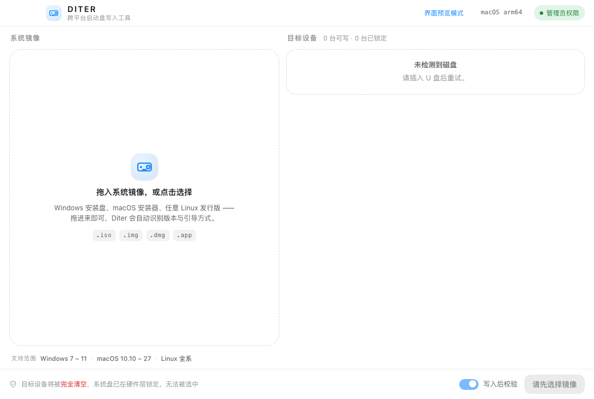

<div align="center">

# Diter

**一个工具，写三种系统。跨平台 U 盘启动盘制作工具 —— 而且永远不会碰你的系统盘。**

[English](README.md) · [中文](README.zh-CN.md)

</div>

Diter 是一款跨平台 USB 启动盘制作工具。不同于只能「写自己那一半」的工具，
Diter 按镜像语义分派正确的写入策略，让 Windows ISO、macOS 安装器、任意 Linux
发行版都能做出**真正可启动**的 U 盘 —— 同时把系统盘挡在可选范围之外。

## 为什么做 Diter

| 工具 | 短板 |
|---|---|
| **Rufus** | Windows 上极强，但写不了 macOS（无 HFS/APFS 写入能力） |
| **createinstallmedia** | 只做 Apple 自家安装器 |
| **Etcher** | 全平台 `dd`，但 Windows ISO 不是混合镜像，`dd` 出来的 U 盘**不可启动** |

Diter 按镜像语义分派引擎，而不是一律 `dd`：

| 目标 | 策略 |
|---|---|
| **Windows ISO** | 分区 → FAT32 → 拷文件 → 引导（`install.wim > 4GB` 自动用 wimlib 拆分） |
| **macOS** | 三级策略：`createinstallmedia` → `asr` → `raw`，覆盖 10.10 到最新 |
| **Linux** | 整盘字节级写入，可选 `casper-rw` 持久化分区 |

## 亮点

- **跨平台** —— macOS / Windows / Linux 宿主都能用
- **镜像识别** —— 直接读文件头（ISO9660、GPT、MBR、HFS+、APFS、UDF、DMG），并给出识别证据链
- **系统盘防护** —— 三道独立闸门，系统盘在内建层就无法被选中
- **提权助手** —— 授权运行的是无窗口后台助手，主窗口不重启、已选内容不丢失
- **写完校验** —— 回读整盘并比对 SHA-256

## 安全模型

1. **枚举期** —— 每台设备算出 `verdict`，被锁定的不进可选项
2. **确认期** —— 勾选 + 长按 1.5 秒
3. **写入前** —— 重新枚举、比对容量、再跑一次 `assertWritable()`

macOS 上系统盘判定的关键：根卷 `/` 挂在**合成盘**（APFS 容器）上，必须沿
`APFSPhysicalStores` 追溯到物理盘，否则会漏判。已在真机实测验证。

## 界面截图



## 快速开始（开发）

```bash
npm install          # 首次运行会下载 Electron 运行时
npm run preview      # 只生成界面预览（不需要 Electron）
npm start            # 构建并启动桌面应用
```

界面预览产物 `preview/diter-preview.html` 是单文件，双击即可查看，用的是模拟
数据，不碰真实磁盘。

## 已打包产物（`release/`）

| 产物 | 平台 | 说明 |
|---|---|---|
| `Diter-0.1.0-mac-x64.dmg` | macOS (x64) | 未签名 —— 首次打开需右键 → 打开 |
| `Diter-win32-x64/Diter.exe` | Windows | 绿色免安装版（整个目录需一起保留） |

重新打包：`npm run package`（见 `build/package.sh`）。

## 目录结构

```
electron/core/     探测 / 安全 / 编排 / 引擎
src/renderer/      React 界面（编译到 Chrome 76，兼容老 Electron）
docs/              ARCHITECTURE.md —— 完整方案、兼容矩阵、选型理由
preview/           界面预览与流程截图
tools/             构建与打包辅助脚本
```

详细设计见 [docs/ARCHITECTURE.md](docs/ARCHITECTURE.md)。

## 技术栈

Electron 33 · React 18 · esbuild —— 纯 Node 原生系统调用（无需编译 Rust/Go
原生依赖）。

## 当前状态与路线图

已完成：镜像识别、磁盘安全判定、写入引擎、完整界面与全流程交互、提权助手、校验。

待补：把 `wimlib`/`ms-sys` 打包进安装包；macOS 助手迁移到 `SMJobBless`；
Windows 侧卷锁定（`FSCTL_LOCK_VOLUME`）。

## 许可证

[MIT](LICENSE)
